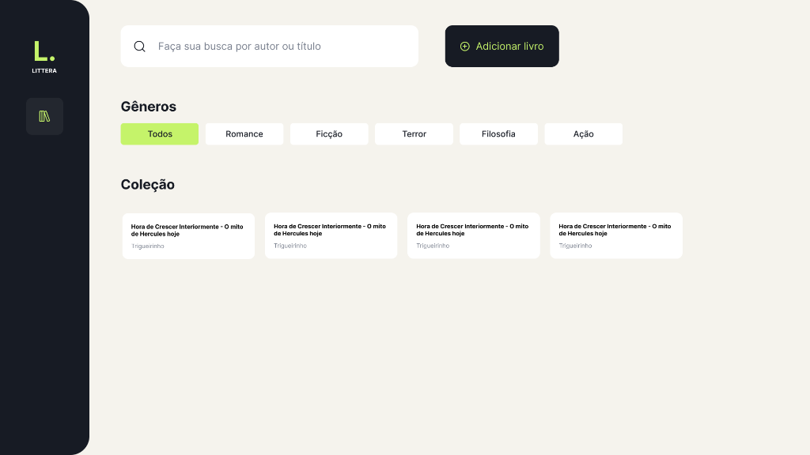
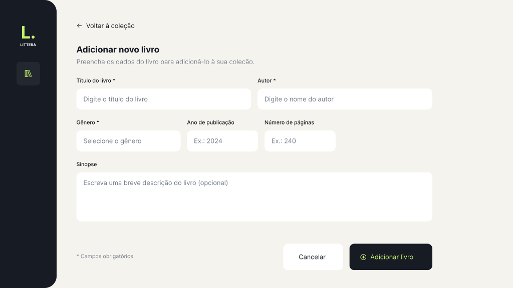
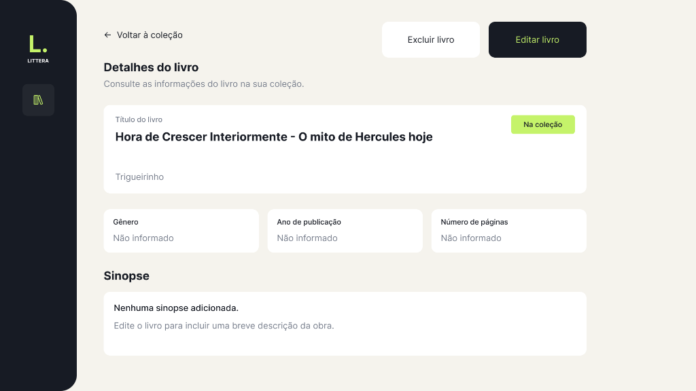
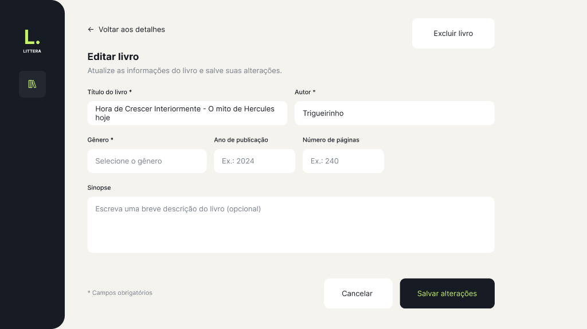

# Littera - Catálogo Simples de Livros

<p align="center">
  
</p>

<p align="center">
  
  
  
  
  
  
</p>

---

## 📖 Sobre o Projeto

O **Littera** é uma aplicação web completa desenvolvida para a catalogação, pesquisa e gerenciamento da coleção pessoal de livros. Construído sob o padrão arquitetural **Model-View-Controller (MVC)** e **Data Access Object (DAO)** em **Java Web nativo (Jakarta Servlets 6.0 + JSP 3.1 com JSTL e Expression Language)** e conectividade **JDBC**.

O projeto conta com interface moderna e responsiva fiel aos leiautes de referência, apresentando barra lateral com identidade visual verde-limão, busca simples por título ou autor, pílulas de filtro por gêneros literários, visualização detalhada com selo *"Na coleção"*, formulários completos de cadastro e edição, e confirmação modal defensiva para exclusão de obras.

---

## 🎓 Identificação Acadêmica

- **Curso:** Bacharelado em Ciência da Computação
- **Disciplina:** Projeto Integrador Transdisciplinar em Ciência da Computação
- **Autor:** Victor Michel Fernandes Leite
- **RGM:** 47117877
- **Período:** Novembro de 2026

---

## 📸 Demonstração Visual das Telas

| 1. Coleção (Home / Busca / Filtro por Gênero) | 2. Formulário de Cadastro de Novo Livro |
|:---:|:---:|
|  |  |
| **3. Detalhes da Obra com Sinopse** | **4. Formulário de Edição** |
|  |  |

---

## 🚀 Funcionalidades

- [x] **Interface Web Intuitiva:** Navegação lateral com marca *L. LITTERA*, cartões dinâmicos e design limpo;
- [x] **Cadastro de Livros:** Inclusão de obras com título, autor, gênero (obrigatórios), ano de publicação, número de páginas e sinopse;
- [x] **Listagem Geral da Coleção:** Visualização de todos os livros em grade responsiva;
- [x] **Visualização de Detalhes:** Apresentação expandida com metadados e selo *Na coleção*;
- [x] **Edição de Obras:** Atualização imediata de dados com formulário pré-preenchido;
- [x] **Exclusão com Diálogo Modal:** Remoção segura de registros com confirmação prévia;
- [x] **Busca Textual Simples:** Pesquisa rápida parametrizada via SQL (`LIKE ?`) por título ou autor;
- [x] **Filtragem por Gênero:** Pílulas dinâmicas (Romance, Ficção, Filosofia, Terror, etc.) integradas ao banco;
- [x] **Persistência Relacional Híbrida:**
  - *SQLite embutido (Padrão Zero-Setup):* Banco autônomo em arquivo local `littera.db`, auto-inicializado no primeiro uso;
  - *MySQL configurável:* Suporte nativo via `db.properties`.

---

## 🛡️ Segurança da Informação (ISO/IEC 27001)

1. **Prevenção contra SQL Injection:** Uso estrito de `PreparedStatement` em 100% das consultas JDBC;
2. **Mitigação de Cross-Site Scripting (XSS):** Saída de dados dinâmicos na camada JSP protegida pela tag JSTL `<c:out value="${...}"/>`;
3. **Validação Defensiva de Entrada:** Tratamento no Servlet de campos obrigatórios, tipos numéricos e comprimentos máximos (`VARCHAR(255)`, `VARCHAR(150)`);
4. **Gerenciamento Seguro de Recursos:** Cláusulas *try-with-resources* em conexões, statements e result sets para prevenir *connection leaks*.

---

## 🏛️ Arquitetura do Software

```
Littera App/
├── src/main/java/com/littera/
│   ├── model/
│   │   ├── Genero.java              # Modelo de Domínio (Gênero)
│   │   └── Livro.java               # Modelo de Domínio (Livro)
│   ├── dao/
│   │   ├── FabricaDeConexoes.java   # Fábrica de conexões JDBC & Auto-seed
│   │   ├── GeneroDAO.java           # Persistência de gêneros
│   │   └── LivroDAO.java            # Persistência de livros (CRUD e buscas SQL)
│   ├── controller/
│   │   └── LivroServlet.java        # Controlador MVC e roteamento
│   └── ServerLauncher.java          # Servidor Apache Tomcat 10 embutido
├── src/main/webapp/
│   ├── WEB-INF/web.xml              # Deployment Descriptor (Jakarta EE 10)
│   ├── css/style.css                # Folha de estilos fiel aos leiautes
│   ├── js/app.js                    # Validação e comportamento modal
│   ├── listar-livros.jsp            # Coleção (Home / Filtros / Busca)
│   ├── adicionar-livro.jsp          # Formulário de cadastro
│   ├── detalhes-livro.jsp           # Visualização de detalhes
│   └── editar-livro.jsp             # Formulário de edição
├── src/test/java/com/littera/
│   ├── LivroDAOTest.java            # Testes do CRUD e consultas SQL (JUnit 5)
│   └── ValidacaoLivroTest.java      # Testes de regras de negócio e contratos
└── docs/
    ├── RELATORIO_TECNICO.pdf        # Relatório Técnico ABNT completo em PDF
    ├── MANUAL_DO_USUARIO.pdf        # Manual do Usuário Simplificado em PDF
    ├── DIAGRAMAS_UML.md             # Diagramas de Casos de Uso, Classes, Sequência e DER
    └── MODELO_BANCO_DADOS.sql       # Scripts DDL e DML
```

---

## ⚡ Como Executar Localmente

### Pré-requisitos
- **Java:** JDK 17, 21 ou 22 instalado.

### Execução Rápida (Zero-Setup)
1. Clone o repositório ou baixe os arquivos:
   ```bash
   git clone https://github.com/SEU_USUARIO/SEU_REPOSITORIO.git
   cd "Littera App"
   ```
2. No Windows, execute o arquivo **`run.bat`** (ou no PowerShell: `.\run.ps1`):
   ```powershell
   .\run.ps1
   ```
3. Abra seu navegador em:
   ```
   http://localhost:8080/livros
   ```

### Compilar e Rodar os Testes (JUnit 5)
Execute o script de build automatizado:
```powershell
.\build.ps1
```
O script compila os fontes, roda os testes unitários (9/9 com 100% de sucesso) e gera o arquivo `target/littera.war`.

---

## 📄 Documentação Completa

- 📘 **[Relatório Técnico (PDF)](docs/RELATORIO_TECNICO.pdf)**: Relatório acadêmico formal em conformidade com as normas ABNT;
- 📗 **[Manual do Usuário (PDF)](docs/MANUAL_DO_USUARIO.pdf)**: Guia simplificado de 2 páginas para instalação e operação;
- 📊 **[Diagramas UML (Markdown)](docs/DIAGRAMAS_UML.md)**: Diagramas interativos em Mermaid (Casos de Uso, Classes, Sequência e DER);
- 🗄️ **[Modelo de Banco de Dados (SQL)](docs/MODELO_BANCO_DADOS.sql)**: Scripts DDL e DML.

---

## 📜 Licença

Projeto desenvolvido para fins acadêmicos sob a licença [MIT](LICENSE).
