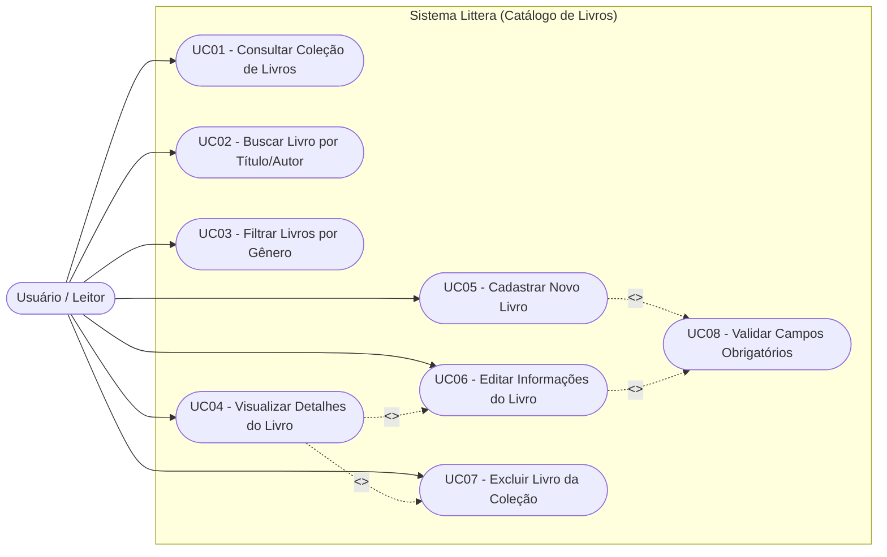
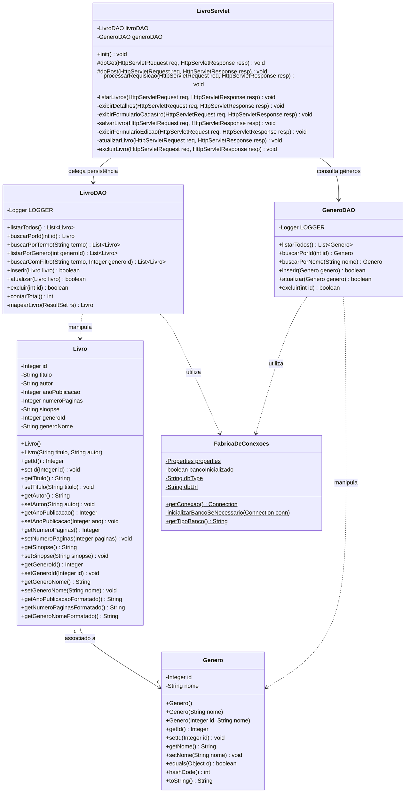
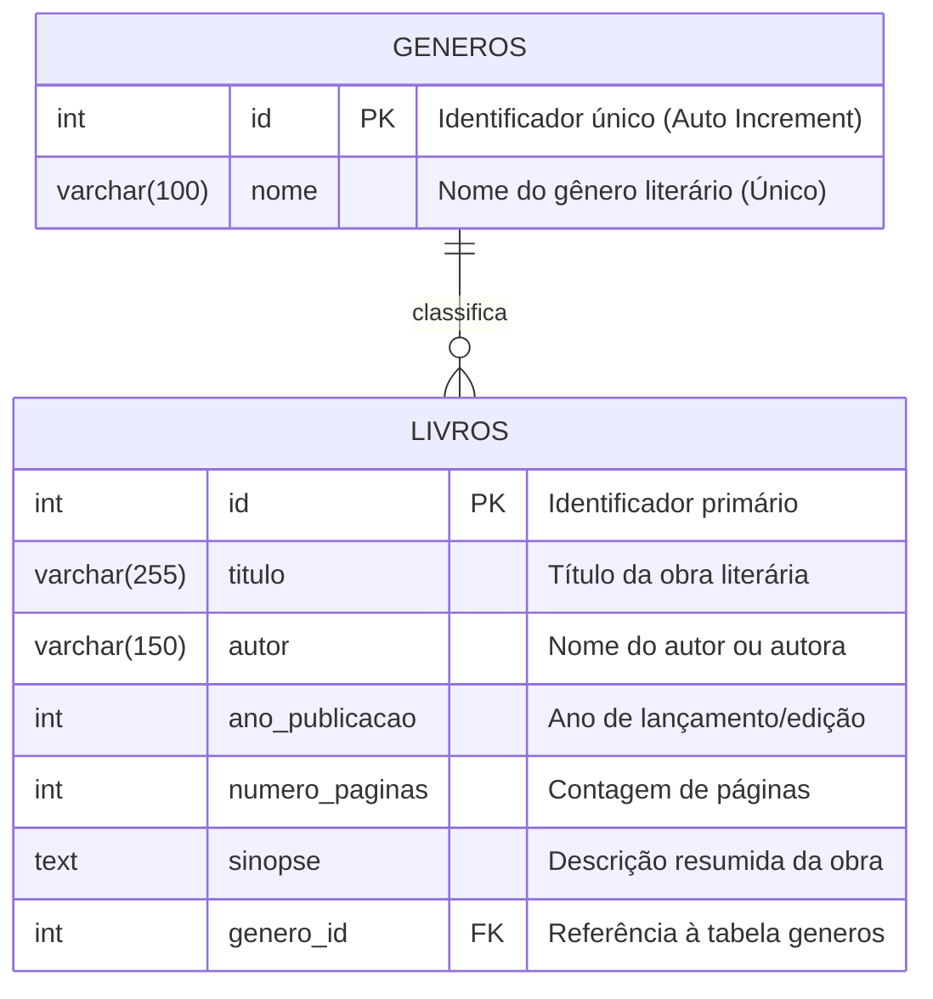
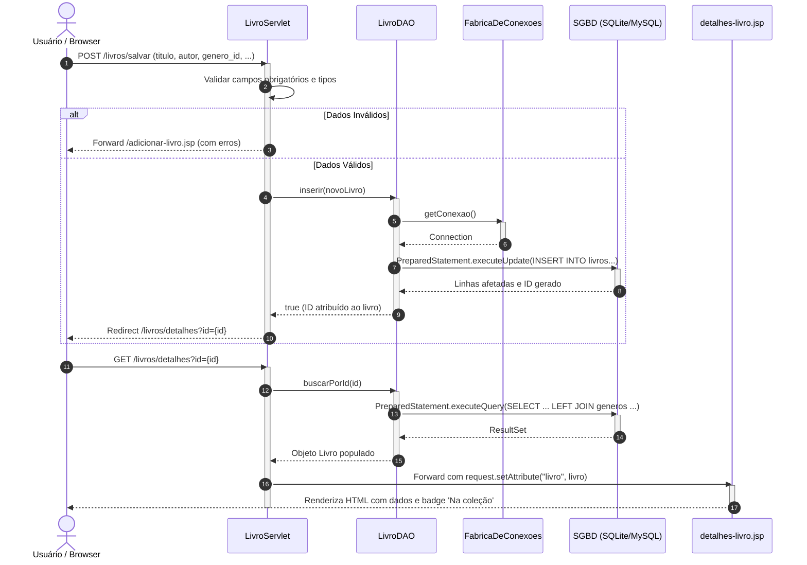

# Littera - Modelagem Visual e Diagramas UML

**Disciplina:** Projeto Integrador Transdisciplinar em Ciência da Computação  
**Autor:** Victor Michel Fernandes Leite | **RGM:** 47117877  
**Curso:** Bacharelado em Ciência da Computação – Novembro de 2026

Este documento reúne os diagramas da modelagem de software do projeto **Littera - Catálogo Simples de Livros**, elaborado segundo as convenções da **UML (Unified Modeling Language)** e modelagem conceitual de banco de dados (DER).

---

## 1. Diagrama de Casos de Uso (UML)

Representa os atores e suas interações com as funcionalidades do sistema.

### Especificação Resumida dos Casos de Uso
- **UC01 - Consultar Coleção:** O usuário acessa a página inicial (`/livros`) e visualiza os cards de todos os livros catalogados.
- **UC02 - Buscar Livro:** O usuário informa um termo no campo de pesquisa e o sistema realiza busca SQL `LIKE ?` em título e autor.
- **UC03 - Filtrar por Gênero:** O usuário seleciona uma pílula de gênero (ex: Filosofia, Ficção) e visualiza apenas obras correspondentes.
- **UC04 - Visualizar Detalhes:** O usuário clica no card e é direcionado para a página com sinopse, ano, páginas e gênero.
- **UC05 - Cadastrar Novo Livro:** O usuário preenche o formulário com dados obrigatórios (título, autor, gênero) e opcionais.
- **UC06 - Editar Livro:** O usuário altera atributos de uma obra existente e confirma as alterações.
- **UC07 - Excluir Livro:** O usuário confirma a remoção do livro através de diálogo modal defensivo.
- **UC08 - Validar Campos:** Validação de integridade no servidor (campos não vazios, limites de caracteres e valores numéricos).

---

## 2. Diagrama de Classes (UML)

Representa a estrutura estática do sistema, os modelos de domínio, controladores e objetos de acesso a dados (padrão MVC + DAO).

---

## 3. Diagrama Entidade-Relacionamento (DER)

Representa o modelo de dados relacional com a cardinalidade entre `generos` e `livros`.

---

## 4. Diagrama de Sequência: Cadastrar Novo Livro

Demonstra a troca de mensagens entre o Navegador, o Servlet Controller, o DAO, a Fábrica de Conexões e a JSP de Visualização.

