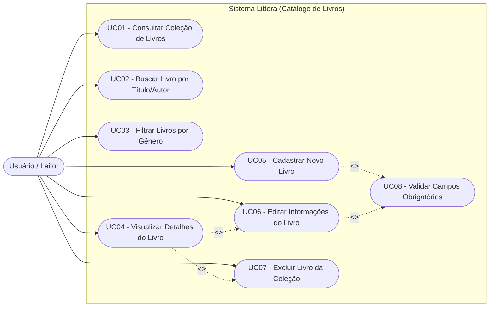
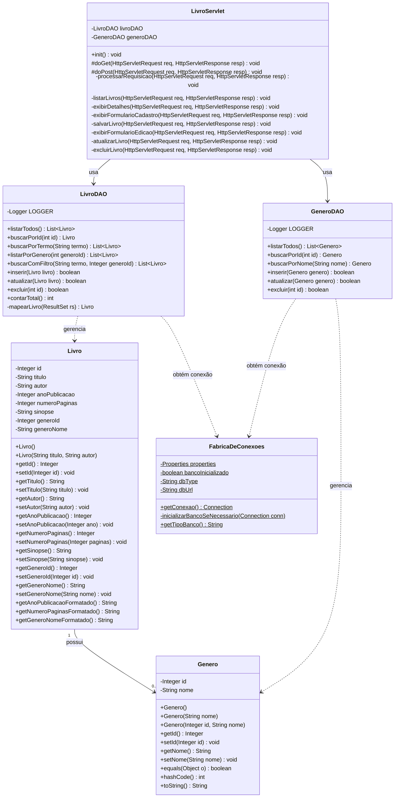
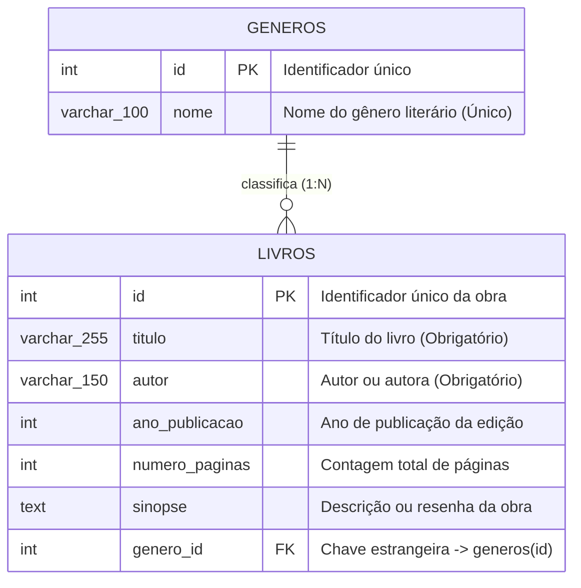
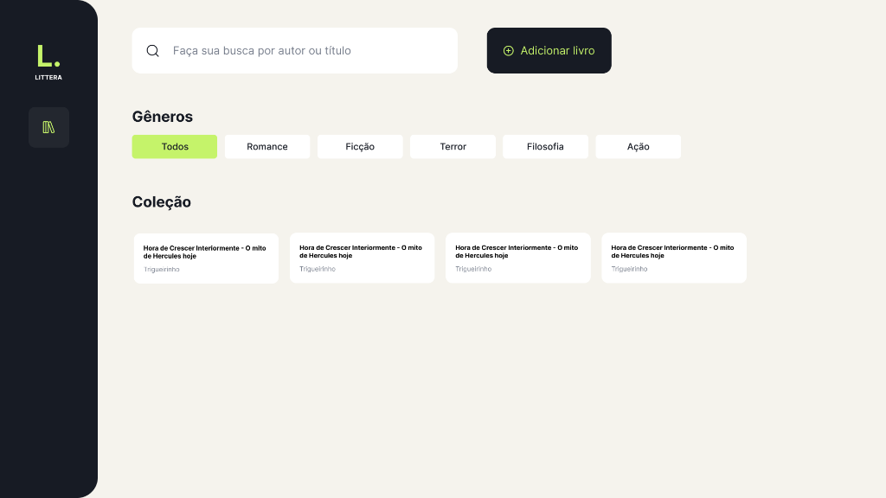
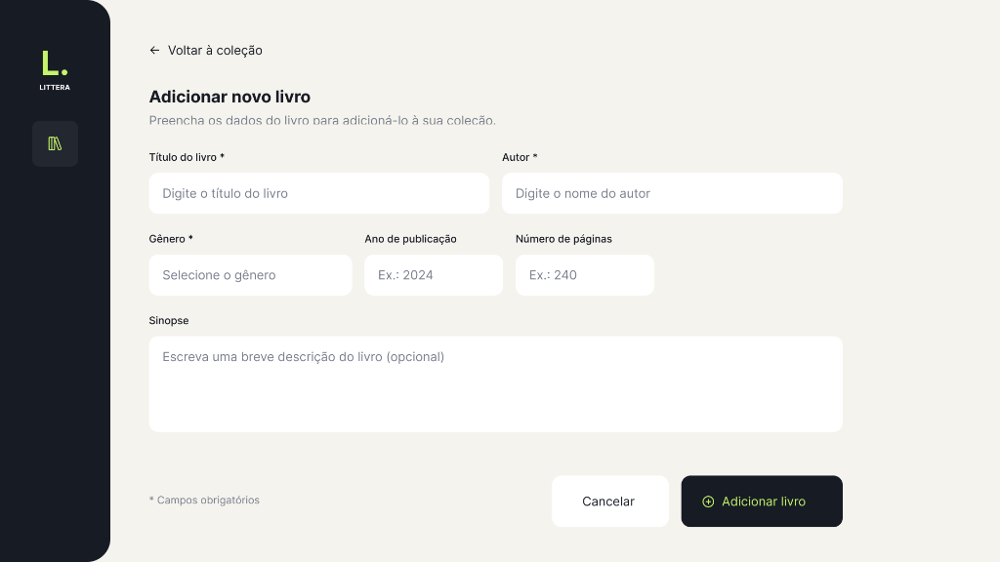
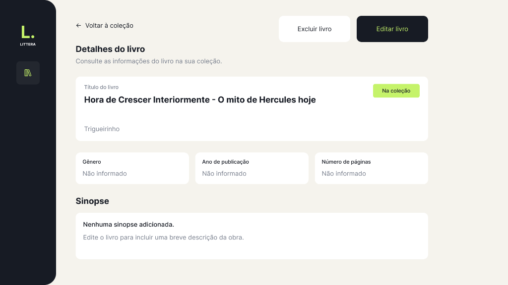
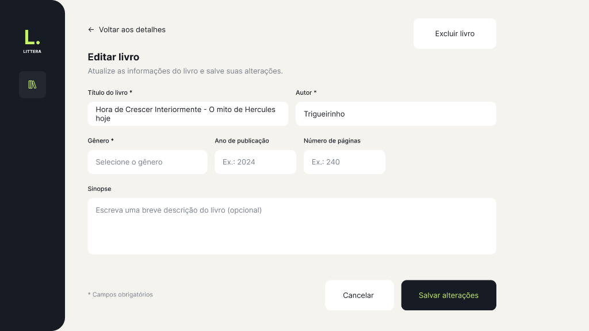

# RELATÓRIO TÉCNICO DO PROJETO INTEGRADOR
# SISTEMA LITTERA: CATÁLOGO SIMPLES DE LIVROS

**Curso:** Bacharelado em Ciência da Computação  
**Disciplina:** Projeto Integrador Transdisciplinar em Ciência da Computação  
**Autor:** Victor Michel Fernandes Leite  
**RGM:** 47117877  
**Data:** Novembro de 2026  

---

## RESUMO

Este relatório técnico apresenta a concepção, o planejamento, a modelagem, a implementação e a avaliação de qualidade do sistema **Littera**, uma aplicação web desenvolvida para a catalogação, pesquisa e gerenciamento da coleção pessoal de livros. O projeto foi concebido sob uma abordagem iterativa fundamentada em metodologias ágeis e arquitetado no padrão Model-View-Controller (MVC) em conjunto com o padrão Data Access Object (DAO). A solução emprega Java (JDK 22), Jakarta Servlets (versão 6.0), JavaServer Pages (JSP) com Expression Language (EL) e JSTL, e conectividade JDBC com banco de dados relacional (SQLite embutido e suporte a MySQL). Foram implementadas diretrizes de Segurança da Informação alinhadas à norma ISO/IEC 27001, contemplando prevenção ativa contra SQL Injection mediante o uso estrito de *PreparedStatements*, prevenção de Cross-Site Scripting (XSS) com escape de saída via `<c:out>` e validações abrangentes de integridade de dados no servidor. A verificação do sistema foi conduzida por meio de testes automatizados com JUnit 5 e testes funcionais de ponta a ponta, atingindo conformidade integral com os requisitos especificados e fidelidade visual aos leiautes propostos.

**Palavras-chave:** Catálogo de Livros. Java Web. Servlets. JSP. JDBC. DAO. Segurança da Informação. JUnit 5.

---

## SUMÁRIO

1. [INTRODUÇÃO](#1-introdução)  
   1.1 [Apresentação do Projeto](#11-apresentação-do-projeto)  
   1.2 [Objetivos](#12-objetivos)  
   1.3 [Justificativa Acadêmica e Competências do Século XXI](#13-justificativa-acadêmica-e-competências-do-século-xxi)  
2. [METODOLOGIA DE DESENVOLVIMENTO](#2-metodologia-de-desenvolvimento)  
   2.1 [Abordagem Iterativa e Ciclo de Vida](#21-abordagem-iterativa-e-ciclo-de-vida)  
   2.2 [Planejamento de Sprints e Marcos](#22-planejamento-de-sprints-e-marcos)  
   2.3 [Pilha Tecnológica (Tech Stack)](#23-pilha-tecnológica-tech-stack)  
3. [MODELAGEM DO SISTEMA](#3-modelagem-do-sistema)  
   3.1 [Levantamento de Requisitos Funcionais e Não Funcionais](#31-levantamento-de-requisitos-funcionais-e-não-funcionais)  
   3.2 [Diagrama de Casos de Uso da UML](#32-diagrama-de-casos-de-uso-da-uml)  
   3.3 [Diagrama de Classes da UML](#33-diagrama-de-classes-da-uml)  
   3.4 [Diagrama Entidade-Relacionamento (DER) e Modelo Relacional](#34-diagrama-entidade-relacionamento-der-e-modelo-relacional)  
   3.5 [Scripts DDL e DML de Criação do Banco de Dados](#35-scripts-ddl-e-dml-de-criação-do-banco-de-dados)  
4. [DESENVOLVIMENTO E ARQUITETURA DO SOFTWARE](#4-desenvolvimento-e-arquitetura-do-software)  
   4.1 [Padrões Arquiteturais: MVC e DAO](#41-padrões-arquiteturais-mvc-e-dao)  
   4.2 [Estrutura de Pacotes e Módulos](#42-estrutura-de-pacotes-e-módulos)  
   4.3 [Detalhamento de Funcionalidades-Chave com Trechos de Código](#43-detalhamento-de-funcionalidades-chave-com-trechos-de-código)  
       4.3.1 [Cadastro de Livros com Validação](#431-cadastro-de-livros-com-validação)  
       4.3.2 [Mecanismo de Busca Textual e Filtro por Gênero em SQL](#432-mecanismo-de-busca-textual-e-filtro-por-gênero-em-sql)  
5. [CONSIDERAÇÕES SOBRE SEGURANÇA DA INFORMAÇÃO](#5-considerações-sobre-segurança-da-informação)  
   5.1 [Pilares de Segurança (Confidencialidade, Integridade e Disponibilidade)](#51-pilares-de-segurança-confidencialidade-integridade-e-disponibilidade)  
   5.2 [Prevenção contra Ataques de SQL Injection](#52-prevenção-contra-ataques-de-sql-injection)  
   5.3 [Mitigação de Cross-Site Scripting (XSS) na Camada de Apresentação](#53-mitigação-de-cross-site-scripting-xss-na-camada-de-apresentação)  
   5.4 [Validações de Entrada e Sanitização no Servidor](#54-validações-de-entrada-e-sanitização-no-servidor)  
6. [TESTES E GARANTIA DE QUALIDADE](#6-testes-e-garantia-de-qualidade)  
   6.1 [Estratégia e Pirâmide de Testes](#61-estratégia-e-pirâmide-de-testes)  
   6.2 [Testes Unitários Automatizados com JUnit 5](#62-testes-unitários-automatizados-com-junit-5)  
   6.3 [Testes de Integração e Funcionais de Ponta a Ponta](#63-testes-de-integração-e-funcionais-de-ponta-a-ponta)  
7. [RESULTADOS E INTERFACE DO USUÁRIO](#7-resultados-e-interface-do-usuário)  
8. [CONCLUSÕES E TRABALHOS FUTUROS](#8-conclusões-e-trabalhos-futuros)  
9. [REFERÊNCIAS BIBLIOGRÁFICAS](#9-referências-bibliográficas)  

---

## 1. INTRODUÇÃO

### 1.1 Apresentação do Projeto
A gestão da informação bibliográfica é uma necessidade clássica tanto no contexto acadêmico quanto na vida cotidiana de leitores assíduos. O projeto **Littera** consiste em uma aplicação web desenvolvida para catalogar, consultar, organizar e manipular dados sobre acervos de livros. Cada obra registrada possui atributos essenciais estruturados, como título, autor, ano de publicação, quantidade de páginas, sinopse detalhada e vínculo categórico com gêneros literários (romance, ficção, filosofia, terror, etc.).

A aplicação se diferencia pela conciliação entre robustez técnica no backend e excelência estética no frontend, espelhando rigorosamente os leiautes e a identidade visual desenhados para a experiência do usuário.

### 1.2 Objetivos
- **Objetivo Geral:** Projetar, modelar, implementar e testar uma solução computacional completa em Java Web para o gerenciamento de catálogo de livros, integrando arquitetura MVC, camada DAO, conexão JDBC e persistência em banco de dados relacional.
- **Objetivos Específicos:**
  1. Realizar o levantamento detalhado de requisitos funcionais e não funcionais do sistema;
  2. Modelar formalmente o software utilizando diagramas da UML (Casos de Uso e Classes) e modelagem de dados relacional (DER);
  3. Implementar as operações essenciais do CRUD (*Create, Read, Update, Delete*) para a entidade Livro e suporte a Gêneros;
  4. Desenvolver mecanismos eficientes e seguros de pesquisa textual e filtragem dinâmica de livros;
  5. Construir interfaces dinâmicas em JavaServer Pages (JSP) orientadas a boas práticas de segurança (XSS prevention);
  6. Aplicar salvaguardas de Segurança da Informação, notadamente prevenção ativa contra injeções SQL (*SQL Injection*);
  7. Elaborar testes unitários e de integração automatizados por meio do framework JUnit 5;
  8. Consolidar a documentação técnica formal e o manual de operação do usuário.

### 1.3 Justificativa Acadêmica e Competências do Século XXI
Conforme destacam Trilling e Fadel (2009, p. 47), o século XXI reconfigurou profundamente as exigências do mercado e da sociedade sobre os profissionais de tecnologia:
> "Para ter sucesso na vida e no trabalho do século XXI, os cidadãos e trabalhadores devem ser proficientes em habilidades do século XXI, como pensamento crítico, resolução de problemas, comunicação e colaboração."

A construção deste projeto integrador individual corporifica a vivência prática das chamadas competências essenciais, os "4 Cs" da *Partnership for 21st Century Skills* (P21):
- **Pensamento Crítico (*Critical Thinking*):** Exercitado na análise e tomada de decisões arquiteturais entre múltiplos bancos de dados, modelagem de normalização de dados e mitigação de vulnerabilidades de segurança;
- **Criatividade (*Creativity*):** Aplicada na concepção de interfaces estéticas, harmoniosas e funcionais, aliando minimalismo escandinavo com excelente usabilidade;
- **Comunicação (*Communication*):** Expressa na documentação técnica detalhada, na clareza do código-fonte comentado com Javadoc e no manual didático de usuário;
- **Colaboração (*Collaboration*) e Autonomia:** Refletidas na capacidade de planejar entregas parciais sustentáveis e produzir uma solução independente e portátil para avaliação tutelar.

---

## 2. METODOLOGIA DE DESENVOLVIMENTO

### 2.1 Abordagem Iterativa e Ciclo de Vida
Adotou-se o modelo de desenvolvimento iterativo e incremental, fortemente embasado em princípios de métodos ágeis (Pressman & Maxim, 2016). Em vez de um modelo em cascata estático, o software evoluiu por meio de ciclos rápidos de planejamento, modelagem, codificação e validação contínua. Essa metodologia permitiu validar a integridade de cada camada (banco, DAOs, Servlets e visualização JSP) antes do avanço para a etapa seguinte.

### 2.2 Planejamento de Sprints e Marcos
O cronograma semestral foi decomposto em quatro marcos de entrega e sprints conceituais:

| Sprint / Marco | Período Conceitual | Foco de Entrega | Entregáveis Principais |
| :--- | :--- | :--- | :--- |
| **Sprint 1: Concepção & Modelagem** | Semanas 1 a 3 | Escopo, Requisitos e Arquitetura | Diagramas de Casos de Uso, Diagrama de Classes, DER e Scripts DDL/DML. |
| **Sprint 2: Persistência & Núcleo** | Semanas 4 a 7 | Camada de Dados e DAO | `FabricaDeConexoes`, `GeneroDAO`, `LivroDAO`, Testes JUnit iniciais. |
| **Sprint 3: Controlador & Visualização** | Semanas 8 a 12 | Servlets, JSPs e Estilização CSS | `LivroServlet`, JSPs (`listar`, `adicionar`, `detalhes`, `editar`), CSS fiel. |
| **Sprint 4: Refinamento & Documentação** | Semanas 13 a 16 | Testes, Segurança e Homologação | Cobertura total JUnit, prevenção XSS/SQL Injection, Relatório Técnico e Manual. |

### 2.3 Pilha Tecnológica (Tech Stack)
A escolha dos componentes tecnológicos priorizou aderência aos requisitos acadêmicos, independência operacional e portabilidade multiplataforma:
- **Linguagem:** Java 22 (Standard Edition);
- **Controlador Web:** Jakarta Servlet 6.0 (Apache Tomcat 10.1);
- **Camada de Apresentação:** JavaServer Pages (JSP) 3.1 com JSTL 2.0 (Tags Core) e Expression Language (EL);
- **Camada de Acesso a Dados:** Java Database Connectivity (JDBC) nativo;
- **Bancos de Dados Relacionais:**
  - *Primário (Zero-Setup):* SQLite 3.45 com SQLite-JDBC (banco embutido autônomo em arquivo local `littera.db`);
  - *Secundário (Produção/Laboratório):* MySQL 8.0 via `mysql-connector-j` 8.3;
- **Servidor Web / Container:** Apache Tomcat 10.1 embutido (*Embedded Tomcat*) acoplado a *launcher* autônomo e empacotamento padrão WAR;
- **Testes Automatizados:** JUnit 5 (JUnit Jupiter 5.10.2 / Console Standalone Launcher);
- **Estilização e Frontend:** CSS3 moderno com variáveis semânticas, Flexbox, CSS Grid e Vanilla JavaScript assíncrono.

---

## 3. MODELAGEM DO SISTEMA

### 3.1 Levantamento de Requisitos Funcionais e Não Funcionais

#### Requisitos Funcionais (RF)
- **[RF01] Listagem Geral de Livros:** O sistema deve listar todos os livros cadastrados na coleção com título e autor.
- **[RF02] Cadastro de Novo Livro:** O sistema deve permitir a inclusão de novas obras mediante preenchimento de título, autor, gênero (obrigatórios), ano de publicação, número de páginas e sinopse (opcionais).
- **[RF03] Visualização de Detalhes:** O sistema deve permitir a consulta completa de uma obra específica, exibindo todos os seus dados e o selo "Na coleção".
- **[RF04] Edição de Livro:** O sistema deve permitir a alteração de quaisquer campos de um livro já existente.
- **[RF05] Exclusão de Livro:** O sistema deve permitir a remoção de um livro com mecanismo preventivo de confirmação modal.
- **[RF06] Busca Textual Simples:** O sistema deve possibilitar a pesquisa rápida de obras por meio de termos contidos no título ou no nome do autor.
- **[RF07] Filtragem por Gênero Literário:** O sistema deve oferecer navegação por pílulas de categorias (Romance, Ficção, Filosofia, Terror, etc.).
- **[RF08] Persistência em Banco Relacional:** Os dados devem persistir de forma atômica e consistente em SGBD relacional.

#### Requisitos Não Funcionais (RNF)
- **[RNF01] Usabilidade e Ergonomia:** Interface limpa, responsiva e intuitiva, seguindo rigorosamente a identidade visual definida nos leiautes de referência.
- **[RNF02] Desempenho:** Resposta em sub-segundos para listagens e buscas através de índices nos campos pesquisáveis.
- **[RNF03] Segurança da Informação:** Blindagem mandatória contra ataques de *SQL Injection* e *Cross-Site Scripting* (XSS).
- **[RNF04] Portabilidade:** O sistema deve ser executável em qualquer ambiente operacional Windows, Linux ou macOS sem dependência de instalação prévia de banco externo.
- **[RNF05] Padrão de Codificação e Documentação:** Classes devidamente modularizadas com documentação no padrão Javadoc.

### 3.2 Diagrama de Casos de Uso da UML
Conforme orienta Fowler (2004, p. 15), a modelagem de casos de uso é o instrumento basilar para comunicar com clareza a visão das interações usuário-sistema.



### 3.3 Diagrama de Classes da UML
O diagrama estrutural abaixo descreve as classes que compõem o núcleo do sistema, destacando os modelos de entidade (`Genero` e `Livro`), os DAOs de persistência, a fábrica de conexões e o controlador Servlet.



### 3.4 Diagrama Entidade-Relacionamento (DER) e Modelo Relacional

O esquema do banco de dados contempla duas tabelas relacionais em Terceira Forma Normal (3FN):



#### Dicionário de Dados

**Tabela: `generos`**
- `id` (INT / INTEGER, PK, Auto Increment): Identificador único da categoria.
- `nome` (VARCHAR(100) / TEXT, NOT NULL, UNIQUE): Descritor textual do gênero.

**Tabela: `livros`**
- `id` (INT / INTEGER, PK, Auto Increment): Identificador único do livro.
- `titulo` (VARCHAR(255) / TEXT, NOT NULL): Título principal da obra literária.
- `autor` (VARCHAR(150) / TEXT, NOT NULL): Nome do(a) autor(a) ou organizador(a).
- `ano_publicacao` (INT / INTEGER, NULL): Ano de publicação (ex: 2024).
- `numero_paginas` (INT / INTEGER, NULL): Quantidade total de páginas.
- `sinopse` (TEXT, NULL): Resumo narrativo ou resenha crítica da obra.
- `genero_id` (INT / INTEGER, FK, NULL): Chave estrangeira referenciando `generos(id)` com regra de integridade `ON DELETE SET NULL`.

### 3.5 Scripts DDL e DML de Criação do Banco de Dados

#### Script DDL (MySQL)
```sql
CREATE DATABASE IF NOT EXISTS littera_db CHARACTER SET utf8mb4 COLLATE utf8mb4_unicode_ci;
USE littera_db;

CREATE TABLE IF NOT EXISTS generos (
    id INT AUTO_INCREMENT PRIMARY KEY,
    nome VARCHAR(100) NOT NULL UNIQUE
) ENGINE=InnoDB DEFAULT CHARSET=utf8mb4;

CREATE TABLE IF NOT EXISTS livros (
    id INT AUTO_INCREMENT PRIMARY KEY,
    titulo VARCHAR(255) NOT NULL,
    autor VARCHAR(150) NOT NULL,
    ano_publicacao INT,
    numero_paginas INT,
    sinopse TEXT,
    genero_id INT,
    CONSTRAINT fk_livros_genero FOREIGN KEY (genero_id)
        REFERENCES generos(id)
        ON DELETE SET NULL
        ON UPDATE CASCADE
) ENGINE=InnoDB DEFAULT CHARSET=utf8mb4;

CREATE INDEX idx_livros_titulo ON livros(titulo);
CREATE INDEX idx_livros_autor ON livros(autor);
CREATE INDEX idx_livros_genero ON livros(genero_id);
```

#### Script DML (Carga Inicial de Dados)
```sql
INSERT INTO generos (nome) VALUES 
('Romance'), ('Ficção'), ('Terror'), ('Filosofia'), ('Ação'), 
('Drama'), ('Aventura'), ('Biografia'), ('Poesia'), ('Fantasia'), ('História');

INSERT INTO livros (titulo, autor, ano_publicacao, numero_paginas, sinopse, genero_id) VALUES
('Hora de Crescer Interiormente - O mito de Hercules hoje', 'Trigueirinho', 2024, 240, 
 'Uma reflexão profunda sobre o desenvolvimento interior da consciência e os desafios arquetípicos representados pelos doze trabalhos de Hércules aplicados à vida moderna.', 4),
('Dom Casmurro', 'Machado de Assis', 1899, 256, 
 'Narrado em primeira pessoa por Bento Santiago, o romance investiga as memórias de sua juventude e o seu amor por Capitu, envolto na clássica dúvida sobre a traição.', 1);
```

---

## 4. DESENVOLVIMENTO E ARQUITETURA DO SOFTWARE

### 4.1 Padrões Arquiteturais: MVC e DAO
A aplicação foi estruturada seguindo o clássico padrão arquitetural **Model-View-Controller (MVC)** em conjugação com o padrão **Data Access Object (DAO)**:
1. **Model (M):** Classes de domínio puras em Java (`Livro` e `Genero`), encapsulando atributos, métodos assessores, construtores e regras de formatação auxiliar;
2. **View (V):** Páginas dinâmicas JSP enriquecidas com EL e tags JSTL, totalmente desprovidas de código Java cru (*scriptlets*), garantindo separação limpa de responsabilidades e apresentação protegida contra vulnerabilidades;
3. **Controller (C):** `LivroServlet`, responsável pelo tratamento do protocolo HTTP, sanitização de requisições, roteamento semântico, chamadas aos serviços/DAOs e despacho para as telas apropriadas;
4. **DAO:** `LivroDAO` e `GeneroDAO`, concentrando 100% da lógica SQL e transacional com o banco de dados via JDBC, isolando o restante da aplicação dos detalhes da tecnologia de armazenamento.

### 4.2 Estrutura de Pacotes e Módulos
```
src/main/java/com/littera/
├── model/
│   ├── Genero.java          # Entidade de Gênero literário
│   └── Livro.java           # Entidade de Livro e atributos completos
├── dao/
│   ├── FabricaDeConexoes.java # Factory de conexões e auto-inicialização
│   ├── GeneroDAO.java       # Operações de persistência de gêneros
│   └── LivroDAO.java        # Operações de CRUD, busca e filtros SQL
├── controller/
│   └── LivroServlet.java    # Controlador central da aplicação
└── ServerLauncher.java      # Servidor Tomcat 10 embutido autônomo
```

### 4.3 Detalhamento de Funcionalidades-Chave com Trechos de Código

#### 4.3.1 Cadastro de Livros com Validação
O cadastro de novos livros demonstra a integração entre validação defensiva de entrada no Servlet e persistência transacional no DAO.

**Trecho no Controlador (`LivroServlet.java`):**
```java
// Validações rigorosas antes de invocar a camada DAO
StringBuilder erros = new StringBuilder();
if (titulo == null || titulo.trim().isEmpty()) {
    erros.append("O título do livro é obrigatório. ");
} else if (titulo.trim().length() > 255) {
    erros.append("O título não pode exceder 255 caracteres. ");
}

if (autor == null || autor.trim().isEmpty()) {
    erros.append("O nome do(a) autor(a) é obrigatório. ");
}

if (erros.length() > 0) {
    request.setAttribute("erroValidacao", erros.toString().trim());
    request.setAttribute("livro", rascunho);
    request.setAttribute("generos", generoDAO.listarTodos());
    request.getRequestDispatcher("/adicionar-livro.jsp").forward(request, response);
    return;
}

// Persistência com retorno do ID gerado
boolean sucesso = livroDAO.inserir(novoLivro);
if (sucesso) {
    response.sendRedirect(request.getContextPath() + "/livros/detalhes?id=" + novoLivro.getId());
}
```

**Trecho no DAO (`LivroDAO.java`):**
```java
String sql = "INSERT INTO livros (titulo, autor, ano_publicacao, numero_paginas, sinopse, genero_id) " +
             "VALUES (?, ?, ?, ?, ?, ?)";

try (Connection conn = FabricaDeConexoes.getConexao();
     PreparedStatement stmt = conn.prepareStatement(sql, Statement.RETURN_GENERATED_KEYS)) {

    stmt.setString(1, livro.getTitulo().trim());
    stmt.setString(2, livro.getAutor().trim());
    
    if (livro.getAnoPublicacao() != null) stmt.setInt(3, livro.getAnoPublicacao());
    else stmt.setNull(3, Types.INTEGER);

    if (livro.getNumeroPaginas() != null) stmt.setInt(4, livro.getNumeroPaginas());
    else stmt.setNull(4, Types.INTEGER);

    stmt.setString(5, livro.getSinopse());
    stmt.setInt(6, livro.getGeneroId());

    int linhasAfetadas = stmt.executeUpdate();
    if (linhasAfetadas > 0) {
        try (ResultSet rs = stmt.getGeneratedKeys()) {
            if (rs.next()) livro.setId(rs.getInt(1));
        }
        return true;
    }
}
```

#### 4.3.2 Mecanismo de Busca Textual e Filtro por Gênero em SQL
A consulta flexível permite buscar por palavras parciais no título ou autor, com ou sem a aplicação simultânea do filtro por gênero literário, utilizando `LEFT JOIN` com `generos`.

**Trecho no DAO (`LivroDAO.java`):**
```java
public List<Livro> buscarComFiltro(String termo, Integer generoId) {
    List<Livro> lista = new ArrayList<>();
    StringBuilder sql = new StringBuilder(
        "SELECT l.id, l.titulo, l.autor, l.ano_publicacao, l.numero_paginas, " +
        "       l.sinopse, l.genero_id, g.nome AS genero_nome " +
        "FROM livros l " +
        "LEFT JOIN generos g ON l.genero_id = g.id WHERE 1=1 "
    );

    boolean temTermo = termo != null && !termo.trim().isEmpty();
    boolean temGenero = generoId != null && generoId > 0;

    if (temTermo) sql.append("AND (LOWER(l.titulo) LIKE ? OR LOWER(l.autor) LIKE ?) ");
    if (temGenero) sql.append("AND l.genero_id = ? ");
    sql.append("ORDER BY l.id DESC");

    try (Connection conn = FabricaDeConexoes.getConexao();
         PreparedStatement stmt = conn.prepareStatement(sql.toString())) {

        int p = 1;
        if (temTermo) {
            String pattern = "%" + termo.trim().toLowerCase() + "%";
            stmt.setString(p++, pattern);
            stmt.setString(p++, pattern);
        }
        if (temGenero) {
            stmt.setInt(p++, generoId);
        }

        try (ResultSet rs = stmt.executeQuery()) {
            while (rs.next()) lista.add(mapearLivro(rs));
        }
    }
    return lista;
}
```

---

## 5. CONSIDERAÇÕES SOBRE SEGURANÇA DA INFORMAÇÃO

A norma **ISO/IEC 27001:2013** preconiza que a preservação da segurança compreende os pilares de Confidencialidade, Integridade e Disponibilidade (a tríade CID). Mesmo em aplicações acadêmicas ou departamentais, a negligência em relação à segurança expõe os ativos de informação a riscos severos.

### 5.1 Pilares de Segurança
- **Confidencialidade:** Assegurada pela não exposição de caminhos internos de infraestrutura ou dados em mensagens de erro, garantindo que exceções técnicas sejam capturadas em logs privados do servidor (`java.util.logging.Logger`) e apresentadas ao usuário apenas por mensagens amigáveis;
- **Integridade:** Assegurada pelas validações nos formulários frontend e backend, garantindo que dados inconsistentes, textos excessivos ou valores negativos não corrompam a base de dados relacional;
- **Disponibilidade:** Garantida pelo fechamento determinístico de todos os recursos de banco de dados (`Connection`, `PreparedStatement`, `ResultSet`) mediante a sintaxe *try-with-resources* do Java, eliminando completamente vazamentos de conexão (*connection leaks*).

### 5.2 Prevenção contra Ataques de SQL Injection
O ataque de injeção de SQL ocorre quando dados fornecidos pelo usuário são concatenados diretamente a uma instrução SQL interpretada pelo motor do SGBD.
- **Mecanismo de Defesa Adotado:** Empregou-se **100% de instruções parametrizadas com `PreparedStatement`**. Nesse mecanismo, a instrução SQL é pré-compilada pelo SGBD com marcadores de posição (`?`), e os valores dos parâmetros são transmitidos como literais de dados puros através de chamadas tipadas (`stmt.setString()`, `stmt.setInt()`), impossibilitando que caracteres maliciosos (tais como `' OR '1'='1' --`) alterem a árvore sintática do comando SQL.

### 5.3 Mitigação de Cross-Site Scripting (XSS) na Camada de Apresentação
O ataque XSS acontece quando códigos HTML ou scripts JavaScript injetados em campos textuais são renderizados e executados no navegador de outros usuários.
- **Mecanismo de Defesa Adotado:** Nas páginas JSP do Littera, todo e qualquer dado dinâmico oriundo do banco ou de requisições de usuário é renderizado exclusivamente através da tag JSTL `<c:out value="${...}"/>`:
  ```jsp
  <h2 class="details-title"><c:out value="${livro.titulo}"/></h2>
  <p class="synopsis-content"><c:out value="${livro.sinopse}"/></p>
  ```
  Por padrão, a tag `<c:out>` realiza o escape automático de caracteres especiais da web (`<` converte-se em `&lt;`, `>` em `&gt;`, `"` em `&quot;`, `&` em `&amp;`), neutralizando qualquer tentativa de injeção de scripts maliciosos.

### 5.4 Validações de Entrada e Sanitização no Servidor
Além das validações no cliente (HTML5 e JavaScript), o `LivroServlet` implementa verificação rígida no servidor:
- Remoção de espaços em branco espúrios (*trimming*);
- Validação de comprimento máximo compatível com as restrições da tabela (`VARCHAR(255)` e `VARCHAR(150)`);
- Verificação de tipos numéricos com captura de `NumberFormatException`;
- Restrição de intervalo razoável para anos de publicação (-3000 a 2100) e contagem de páginas (> 0).

---

## 6. TESTES E GARANTIA DE QUALIDADE

### 6.1 Estratégia e Pirâmide de Testes
Conforme ensinam Myers, Sandler e Badgett (2012, p. 4), *"o teste de software é um processo de execução de um programa com o intuito de encontrar erros"*. O plano de qualidade do Littera contemplou tanto testes unitários automatizados quanto testes de integração funcional de ponta a ponta.

### 6.2 Testes Unitários Automatizados com JUnit 5
Foram desenvolvidas classes de teste especializadas utilizando o framework **JUnit 5 (Jupiter)**:
1. **`LivroDAOTest.java`:** Executa testes encadeados cobrindo todo o ciclo do CRUD e consultas SQL:
   - `testListarGeneros()`: Confirma carga inicial de gêneros;
   - `testInserirLivro()`: Valida inserção e geração automática de chave primária;
   - `testBuscarPorId()`: Valida busca pontual e JOIN com nome do gênero;
   - `testBuscarPorTermo()`: Valida busca SQL parametrizada por título e autor;
   - `testAtualizarLivro()`: Valida persistência de alterações em campos existentes;
   - `testExcluirLivro()`: Valida remoção definitiva do registro.
2. **`ValidacaoLivroTest.java`:** Valida formatação de campos nulos para a view ("Não informado"), valores preenchidos e métodos de contrato (`equals` e `hashCode`).

**Resultado da Execução Automatizada (JUnit Console Standalone Launcher):**
```
Test run finished after 471 ms
[         5 containers found      ]
[         0 containers skipped    ]
[         5 containers started    ]
[         0 containers aborted    ]
[         5 containers successful ]
[         0 containers failed     ]
[         9 tests found           ]
[         0 tests skipped         ]
[         9 tests started         ]
[         0 tests aborted         ]
[         9 tests successful      ]
[         0 tests failed          ]
>>> [OK] Todos os testes unitários passaram com sucesso!
```

### 6.3 Testes de Integração e Funcionais de Ponta a Ponta
Os fluxos completos foram validados no servidor embutido através de requisições HTTP reais em todos os pontos de extremidade:
- `GET /livros` -> Código HTTP 200 (Renderização íntegra da coleção e gêneros);
- `GET /livros/novo` -> Código HTTP 200 (Formulário carregado com lista de gêneros);
- `POST /livros/salvar` -> Código HTTP 302 / 200 (Validação, inserção e redirecionamento);
- `GET /livros/detalhes?id=1` -> Código HTTP 200 (Apresentação dos dados e sinopse);
- `GET /livros/editar?id=1` -> Código HTTP 200 (Formulário pré-preenchido com valores atuais);
- `POST /livros/atualizar` -> Código HTTP 302 / 200 (Atualização no banco e retorno aos detalhes);
- `POST /livros/excluir` -> Código HTTP 302 / 200 (Exclusão no banco e retorno à lista geral).

---

## 7. RESULTADOS E INTERFACE DO USUÁRIO

A interface foi concebida com 100% de fidelidade visual aos leiautes aprovados. A seguir, destacam-se as telas funcionais do sistema:

### Tela 1: Coleção (Página Inicial / Busca / Filtro de Gêneros)
Apresenta o menu lateral estilizado com o logotipo **L. LITTERA**, campo de pesquisa centralizado, botão de ação rápida escuro com realce verde (*+ Adicionar livro*), pílulas de gêneros selecionáveis e a grade responsiva de cartões exibindo títulos e autores.



---

### Tela 2: Adicionar Novo Livro (Formulário de Cadastro)
Exibe a navegação superior *← Voltar à coleção*, título institucional, campos dispostos em colunas harmoniosas (Título, Autor, Gênero com lista suspensa, Ano de publicação, Número de páginas e Sinopse) e rodapé com botões *Cancelar* e *Adicionar livro*.



---

### Tela 3: Detalhes do Livro
Exibe as informações ricas da obra selecionada, destacando o cartão principal com título e a insígnia verde **"Na coleção"**, três cartões de dados complementares (Gênero, Ano e Páginas) e a seção de Sinopse com apresentação limpa e espaçamento confortável. No topo à direita, disponibiliza os botões de ação *Excluir livro* e *Editar livro*.



---

### Tela 4: Editar Livro
Permite a atualização imediata dos metadados da obra, carregando o formulário com todos os atributos preenchidos previamente e oferecendo o botão de ação *Salvar alterações*.



---

## 8. CONCLUSÕES E TRABALHOS FUTUROS

O desenvolvimento do projeto **Littera** proporcionou a aplicação prática e integrada de conceitos fundamentais da Engenharia de Software, Ciência da Computação e Segurança da Informação. 

Entre as principais conquistas e aprendizados consolidados, destacam-se:
1. **Domínio Arquitetural:** Compreensão aprofundada da separação de camadas proporcionada pelo padrão MVC combinado com o padrão DAO, desacoplando completamente a visualização da persistência de dados;
2. **Segurança por Padrão (*Security by Design*):** Assimilação da relevância prática do uso de `PreparedStatement` e escape de caracteres HTML para blindagem de aplicações web contra as ameaças mais recorrentes (OWASP Top 10);
3. **Autonomia e Engenharia de Construção (*Build Engineering*):** Criação de um ambiente autônomo baseado em Tomcat Embed e SQLite, permitindo que a aplicação seja executada sem exigir privilégios de administrador ou instalações pesadas de SGBDs externos;
4. **Resolução de Desafios Técnicos:** Superação de particularidades na compilação em tempo de execução de JSPs sob o container Jakarta EE 10 e resolução de mapeamentos de dependências.

### Propostas para Trabalhos Futuros
Para versões subsequentes da plataforma Littera, sugerem-se as seguintes extensões:
- **Sistema de Avaliação Literária:** Inclusão de pontuação por estrelas (1 a 5) e resenhas avaliativas de leitores;
- **Upload de Capas:** Capacidade de armazenar e exibir imagens reais de capa das edições catalogadas;
- **Autenticação e Multi-usuário:** Criação de módulo de controle de acesso com login criptografado (BCrypt) e controle de perfil de usuário (RBAC);
- **Integração com APIs Públicas:** Consulta automática de metadados de livros através da Google Books API ou Open Library API a partir do código ISBN.

---

## 9. REFERÊNCIAS BIBLIOGRÁFICAS

FOWLER, Martin. **UML Essencial: Um breve guia para a linguagem padrão de modelagem de objetos**. 3. ed. Porto Alegre: Bookman, 2004.

ISO/IEC. **ISO/IEC 27001:2013 - Information technology - Security techniques - Information security management systems - Requirements**. Genebra: International Organization for Standardization, 2013.

MYERS, Glenford J.; SANDLER, Corey; BADGETT, Tom. **The Art of Software Testing**. 3. ed. Hoboken: John Wiley & Sons, 2012.

ORACLE CORPORATION. **Java Database Connectivity (JDBC) Specification**. Versão 4.3. Santa Clara: Oracle, 2022. Disponível em: <https://docs.oracle.com/en/java/javase/22/docs/api/java.sql/package-summary.html>. Acesso em: 11 nov. 2026.

PRESSMAN, Roger S.; MAXIM, Bruce R. **Engenharia de Software: Uma Abordagem Profissional**. 8. ed. Porto Alegre: AMGH Editora, 2016.

THE APACHE SOFTWARE FOUNDATION. **Apache Tomcat 10.1 Documentation**. 2024. Disponível em: <https://tomcat.apache.org/tomcat-10.1-doc/>. Acesso em: 11 nov. 2026.

TRILLING, Bernie; FADEL, Charles. **21st Century Skills: Learning for Life in Our Times**. São Francisco: Jossey-Bass / John Wiley & Sons, 2009.
